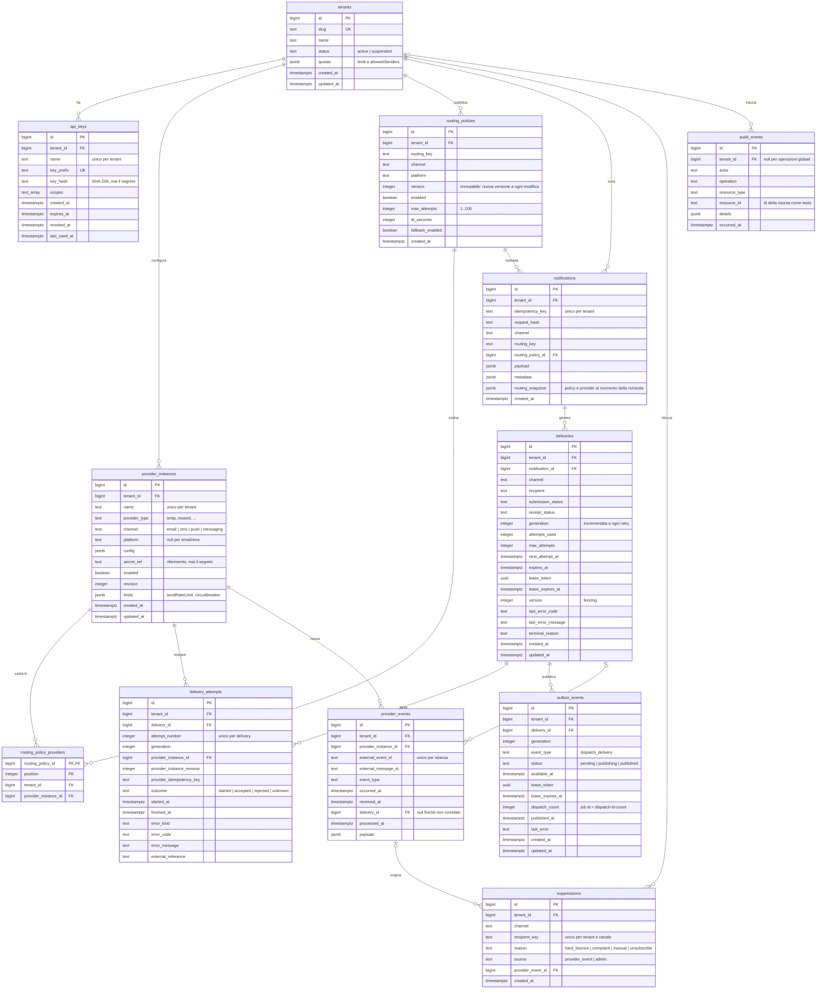

# Schema database

Schema PostgreSQL del servizio, definito a mano nelle migration in `src/infrastructure/database/migrations/` (fonte di verità) e rispecchiato dalle entità MikroORM in `src/infrastructure/database/entities.ts` (verificato da `tests/integration/database/schema.test.ts`).

## Convenzioni

- **Chiavi primarie**: `bigint generated always as identity`. Gli id li assegna solo PostgreSQL (un `insert` con `id` esplicito è rifiutato); l'applicazione li legge con `insert ... returning id`. Nell'API sono numeri JSON interi positivi (esatti fino a 2^53 − 1); nei path (`/v1/notifications/{id}`) sono validati come stringa decimale.
- **Chiavi esterne**: colonne `bigint`. Le relazioni tenant-scoped usano FK composite `(tenant_id, x_id) → (tenant_id, id)`, così una riga non può puntare a dati di un altro tenant.
- **Id sequenziali e unicità globale**: dopo un reset del database (o tra ambienti diversi) gli id si ripetono. Per questo la chiave di idempotenza verso il provider e il `Message-ID` SMTP includono anche l'istante di creazione della notifica.
- **Timestamp**: `timestamptz(3)` (millisecondi, round-trip esatto con `Date` JS, necessario per la paginazione keyset su `created_at, id`).
- **Stati**: `text` + vincoli `CHECK` allineati a `src/contracts/statuses.ts`.
- **Token di lease** (`lease_token`): `uuid` casuali generati dal DB a ogni claim; non sono chiavi ma token di fencing.

## Diagramma ER

## Tabelle

| Tabella                    | Ruolo                                                                                                                                                                   |
| -------------------------- | ----------------------------------------------------------------------------------------------------------------------------------------------------------------------- |
| `tenants`                  | Clienti del servizio; `quotas` contiene limiti e mittenti ammessi (`allowedSenders`). Gestiti da `config:apply`.                                                        |
| `api_keys`                 | Chiavi `ns_<prefisso>_<segreto>`: si salvano prefisso (lookup) e hash SHA-256. Revoca irreversibile.                                                                    |
| `provider_instances`       | Configurazioni dei provider (SMTP, Resend, …) per tenant; `revision` cresce a ogni modifica, i segreti sono solo riferimenti (`secret_ref`).                            |
| `routing_policies`         | Regole `routing_key + channel + platform` → provider, versionate (ogni modifica crea una nuova versione).                                                               |
| `routing_policy_providers` | Ordine dei provider di una versione di policy (posizione 0 = primario, le successive sono fallback).                                                                    |
| `notifications`            | Richiesta accettata dall'API, idempotente su `(tenant_id, idempotency_key)`; conserva payload e snapshot del routing.                                                   |
| `deliveries`               | Stato di consegna verso un destinatario: stato di invio, ricevuta, budget tentativi, lease e fencing (`version`, `generation`).                                         |
| `delivery_attempts`        | Ogni chiamata a un provider, registrata come `started` prima dell'invio; un esito ambiguo resta `unknown` e non viene mai reinviato a un altro provider.                |
| `outbox_events`            | Outbox transazionale: il dispatcher li reclama con `FOR UPDATE SKIP LOCKED` e li pubblica su BullMQ.                                                                    |
| `provider_events`          | Eventi webhook verificati (consegnato, bounce, …), deduplicati per `(provider_instance_id, external_event_id)` e correlati alla delivery tramite `external_message_id`. |
| `suppressions`             | Destinatari bloccati (hard bounce, complaint, manuale) per tenant e canale.                                                                                             |
| `audit_events`             | Traccia delle operazioni amministrative e dei retry manuali.                                                                                                            |

## Indici principali

| Indice                                       | Uso                                               |
| -------------------------------------------- | ------------------------------------------------- |
| `notifications_tenant_id_created_at_index`   | Lista notifiche per tenant, paginazione keyset    |
| `deliveries_ready_index`                     | Delivery eseguibili per stato e `next_attempt_at` |
| `deliveries_sending_lease_index` (parziale)  | Lease scaduti in `sending` → `unknown`            |
| `outbox_events_available_index` (parziale)   | Eventi da pubblicare                              |
| `outbox_events_published_index` (parziale)   | Pubblicazioni perse da riarmare                   |
| `delivery_attempts_external_reference_index` | Correlazione webhook ↔ tentativo                  |
| `provider_events_message_index`              | Correlazione eventi per `external_message_id`     |
| `provider_events_unprocessed_index`          | Eventi da elaborare                               |
| `audit_events_tenant_id_occurred_at_index`   | Audit per tenant nel tempo                        |

## Reset locale

Il database locale si ricrea da zero eliminando i volumi: `make clean && make up` (applica le migration all'avvio tramite il servizio `migrate`). Valkey va svuotato insieme al database: i job BullMQ usano id `dispatch-<outbox_id>-<n>` che, con id sequenziali ripartiti da 1, colliderebbero con job ancora presenti.
