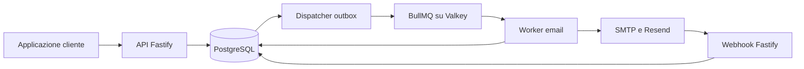

# Progettazione del microservizio di notifiche

## Obiettivo e perimetro

Realizzare un servizio asincrono per email, SMS, notifiche push e messaggistica, con più provider configurabili per ciascun canale. Stack richiesto: Fastify, MikroORM, PostgreSQL, BullMQ, Valkey e Docker. Questo documento definisce le decisioni architetturali e il piano operativo per la successiva implementazione mediante subagent.

Il primo rilascio implementa email transazionali con due adapter: SMTP generico e Resend via HTTP. SMTP permette anche il collaudo locale; Resend è la scelta iniziale proposta per verificare un'integrazione con idempotenza e webhook. Entrambi sono sostituibili senza cambiare il dominio. Non sono richiesti account reali per sviluppare o eseguire i test.

Assunzioni iniziali: servizio interno chiamato da applicazioni autenticate, singolo destinatario e singolo canale per richiesta, invio immediato, nessuna interfaccia amministrativa. Predisporre l'isolamento per applicazione cliente tramite `tenantId`, anche se inizialmente ne esiste una sola. Volumi, SLA e requisiti di residenza dei dati restano da dimensionare prima della produzione.

Fuori dal primo rilascio: campagne, allegati, CC/BCC, template gestiti dal servizio, invii massivi, pianificazioni utente, conversazioni bidirezionali e fallback automatico tra canali. L'HTML email arriva già composto dal chiamante. Gli altri canali hanno contratti ed estensioni definite, ma vengono rifiutati finché non sono abilitati e implementati.

## Architettura

Un unico progetto TypeScript, con moduli di dominio indipendenti dagli SDK e tre processi avviabili separatamente dalla stessa immagine Docker:

- **API Fastify**: autenticazione, validazione, creazione e consultazione notifiche, ricezione webhook.
- **Dispatcher**: pubblicazione dell'outbox, riconciliazione delle consegne ferme e manutenzione periodica.
- **Worker**: consumo BullMQ, selezione provider, invio e registrazione dell'esito.



PostgreSQL è la fonte autorevole per richieste, tentativi ed esiti. BullMQ trasporta riferimenti alle consegne ed esegue il lavoro. L'API non effettua invii e non dipende da una scrittura simultanea su database e coda.

Usare transazioni brevi e un `EntityManager` isolato per richiesta HTTP, job e ciclo del dispatcher. Non condividere l'identity map tra elaborazioni concorrenti e non mantenere transazioni aperte durante chiamate ai provider. Questo utilizzo segue il modello di [RequestContext di MikroORM](https://mikro-orm.io/docs/identity-map).

## Tecnologie e struttura del progetto

Adottare TypeScript in modalità strict, ESM e npm con lockfile. Nel bootstrap scegliere versioni stabili compatibili di Node.js LTS, Fastify, MikroORM, BullMQ, Valkey e PostgreSQL; registrare la matrice nel README e fissare versioni e immagini. Non usare tag Docker `latest`. Tutti i pacchetti MikroORM devono avere versioni allineate.

```text
src/
  entrypoints/             api.ts, worker.ts, dispatcher.ts
  config/                  parsing e validazione della configurazione
  contracts/               DTO, JSON Schema, tipi canali e porte provider
  domain/                  stati, errori, routing e regole di retry
  application/             casi d'uso e interfacce repository
  infrastructure/
    database/              entità MikroORM, repository e migrazioni
    queue/                 producer e consumer BullMQ
    providers/email/       adapter SMTP e Resend
    security/              API key e risoluzione segreti
  http/                    plugin Fastify, route e webhook
tests/
  unit/
  integration/
  contract/
  e2e/
docs/
docker/
```

Il dominio dipende da interfacce, non da Fastify, BullMQ o SDK dei provider. Usare JSON Schema e TypeBox per DTO e validazione HTTP, OpenAPI generata dagli stessi schemi. Gli schemi sono definiti nel codice: Fastify avverte di non compilare schemi forniti dagli utenti. [Validazione Fastify](https://fastify.dev/docs/latest/Reference/Validation-and-Serialization/).

Convenzioni da introdurre: due spazi, Prettier, ESLint, nomi file `kebab-case`, classi e tipi `PascalCase`, funzioni `camelCase`, tabelle e colonne `snake_case`. Test `*.test.ts` con Vitest; `fastify.inject()` per le route.

## Canali e provider

Distinguere il **canale**, che definisce destinatario e contenuto, dal **tipo di provider**, che implementa il trasporto, e dall'**istanza provider**, che identifica account, credenziali e limiti di utilizzo. Due account SMTP sono due istanze dello stesso tipo.

| Canale      | Destinatario e contenuto                                | Estensioni previste       |
| ----------- | ------------------------------------------------------- | ------------------------- |
| `email`     | Indirizzo, mittente, oggetto, testo e/o HTML            | SMTP, Resend, SES, altri  |
| `sms`       | Numero E.164, testo, identità mittente                  | Provider SMS multipli     |
| `push`      | Piattaforma e device token, titolo, corpo, dati         | FCM, APNs, altri          |
| `messaging` | Piattaforma, identità destinatario, contenuto specifico | WhatsApp, Telegram, altri |

Per `messaging`, `platform` distingue WhatsApp da Telegram: non sono provider intercambiabili. Il fallback è consentito soltanto tra provider che possono raggiungere lo stesso destinatario sulla stessa piattaforma. Anche push richiede compatibilità esplicita con piattaforma e token.

Definire una mappa TypeScript `PayloadByChannel` come unione discriminata, senza payload generici `any`. I contenuti di messaggistica potranno distinguere testo e template approvati, con capacità verificabili per ciascun adapter.

La porta `ProviderAdapter<C>` espone:

- `capabilities`: canali, piattaforme, formati, idempotenza, ricevute e interrogazione dello stato supportati.
- `validateConfig(config)`: verifica della configurazione dell'istanza.
- `send(payload, context)`: esito normalizzato, con timeout e chiave idempotente quando supportata.
- `getStatus(reference)`: opzionale, per riconciliazione.
- `verifyAndParseWebhook(rawBody, headers)`: opzionale, autenticazione e normalizzazione degli eventi.

`context` contiene `deliveryId`, `attemptId`, istanza provider, chiave idempotente e `AbortSignal`. `send` restituisce `accepted`, `rejected` o `unknown`, con riferimento esterno se disponibile; gli errori specificano `retryable`, `permanent` o `configuration`, eventuale `retryAfter` e se il provider ha certamente rifiutato l'invio.

Il routing usa una policy versionata per tenant, canale e piattaforma. Filtra istanze abilitate e capacità richieste, quindi applica una priorità deterministica. Il chiamante indica una `routingKey` autorizzata, mai credenziali o URL arbitrari. Alla creazione si salva lo snapshot della policy e del contenuto; un kill switch sull'istanza può comunque impedirne l'utilizzo.

Nell'MVP, configurare istanze e policy tramite comando amministrativo idempotente da file validato. Il database conserva riferimenti a segreti, non i segreti stessi. La gestione CRUD via API viene rinviata.

## Modello dati PostgreSQL

Usare UUID, date `timestamptz` in UTC, migrazioni versionate e vincoli SQL. JSONB è adatto a payload e metadati specifici dei canali; stato, relazioni e campi di ricerca restano colonne esplicite.

| Entità               | Responsabilità e campi principali                                                                                               |
| -------------------- | ------------------------------------------------------------------------------------------------------------------------------- |
| `tenants`            | Applicazione cliente, stato e quote                                                                                             |
| `api_keys`           | Tenant, hash della chiave, prefisso, scope, revoca                                                                              |
| `provider_instances` | Tenant, tipo, canale/piattaforma, config non segreta, `secret_ref`, abilitazione, revisione                                     |
| `routing_policies`   | Tenant, chiave, versione, provider ordinati, limiti e criteri di fallback                                                       |
| `notifications`      | Tenant, `idempotency_key`, hash richiesta, payload immutabile, policy snapshot, data creazione                                  |
| `deliveries`         | Notifica, destinatario, canale, stato invio, stato ricevuta, `generation`, `next_attempt_at`, `expires_at`, lease e versione    |
| `delivery_attempts`  | Delivery, numero tentativo, istanza/revisione, idempotency key provider, inizio/fine, esito, codice errore, riferimento esterno |
| `outbox_events`      | Delivery, generazione, tipo, `available_at`, stato pubblicazione, lease, contatore dispatch, errore tecnico                     |
| `provider_events`    | Istanza, ID evento esterno, riferimento messaggio, tipo, data provider/ricezione, elaborazione e payload minimizzato            |
| `suppressions`       | Tenant, canale, destinatario normalizzato, motivo, origine e data                                                               |
| `audit_events`       | Attore, operazione amministrativa, risorsa e data, senza contenuti o segreti                                                    |

Relazioni: una notifica ha una delivery nell'MVP; una delivery ha più tentativi ed eventi. La separazione consente un successivo fan-out senza cambiare il significato dei tentativi.

Vincoli necessari:

- Unicità `(tenant_id, idempotency_key)` sulle notifiche e `(delivery_id, attempt_number)` sui tentativi.
- Unicità `(provider_instance_id, external_event_id)` sugli eventi webhook.
- Unicità dell'intento outbox `(delivery_id, generation, event_type)`.
- Chiavi esterne composite con tenant dove serve impedire collegamenti tra clienti.
- Indici sulle consegne pronte per stato/data, outbox pendente per disponibilità, notifiche per tenant/data e riferimenti messaggio per istanza provider.

Isolare esplicitamente tutte le query per tenant; non affidarsi soltanto a filtri ORM impliciti. Non condividere istanze provider fra tenant nel primo rilascio. Le soppressioni usano una normalizzazione specifica del canale, evitando trasformazioni distruttive degli indirizzi email.

## API pubblica

Autenticazione `Authorization: Bearer <api-key>`, TLS in ingresso e tenant derivato dalla chiave. Scope iniziali: `notifications:write`, `notifications:read`, `notifications:retry`; operazioni amministrative separate.

| Metodo e percorso                             | Comportamento                                                                          |
| --------------------------------------------- | -------------------------------------------------------------------------------------- |
| `POST /v1/notifications`                      | Valida e registra richiesta, delivery e outbox; risponde `202` dopo il commit          |
| `GET /v1/notifications/:id`                   | Stato invio/ricevuta, tentativi sintetici e ultimo errore sanificato                   |
| `GET /v1/notifications`                       | Ricerca per stato/canale/data con paginazione a cursore                                |
| `POST /v1/notifications/:id/retry`            | Retry manuale autorizzato e idempotente, solo per fallimenti sicuramente non accettati |
| `POST /v1/webhooks/:providerType/:instanceId` | Endpoint pubblico autenticato tramite firma del provider                               |
| `GET /health/live`                            | Processo attivo                                                                        |
| `GET /health/ready`                           | Dipendenze necessarie al ruolo disponibili                                             |

Esempio MVP:

```http
POST /v1/notifications
Authorization: Bearer <api-key>
Idempotency-Key: order-123-confirmation-v1
Content-Type: application/json

{
  "channel": "email",
  "routingKey": "transactional",
  "recipient": { "email": "cliente@example.com" },
  "content": {
    "from": "Ordini <ordini@example.com>",
    "subject": "Conferma ordine 123",
    "text": "Il tuo ordine è stato ricevuto.",
    "html": "<p>Il tuo ordine è stato ricevuto.</p>"
  },
  "metadata": { "orderId": "123" }
}
```

Risposta: `202`, header `Location` e corpo `{ "id": "<uuid>", "submissionStatus": "pending" }`. La risposta iniziale è conservata per i replay idempotenti; lo stato aggiornato si legge con GET.

`Idempotency-Key` è obbligatoria e limitata al tenant. Stessa chiave e stesso hash del payload canonico restituiscono la stessa risposta senza creare consegne; payload diverso produce `409`. Gestire anche richieste simultanee tramite vincolo SQL. Conservare chiave e hash per almeno 30 giorni e comunque finché esistono elaborazioni aperte; dopo la scadenza l'idempotenza non è garantita. Il corpo canonico include routing, contenuto, destinatario e metadata, senza includere segreti.

Errori uniformi `{ code, message, requestId, details? }`: `400` schema, `401/403` autenticazione/autorizzazione, `404` risorsa non visibile, `409` conflitto, `422` canale non abilitato o nessuna route compatibile, `429` quota cliente, `503` indisponibilità delle dipendenze necessarie. Se Valkey è fermo ma PostgreSQL è disponibile, l'API può accettare richieste nell'outbox entro una soglia configurata di backlog; oltre la soglia risponde `503`.

Limiti iniziali proposti: corpo 256 KiB, metadata 4 KiB, una sola mailbox destinataria, mittente autorizzato per tenant e policy, almeno testo o HTML. Vietare allegati, header arbitrari, campi sconosciuti e URL provider forniti dal chiamante. Pubblicare questi limiti in OpenAPI.

## Invio affidabile e gestione della concorrenza

1. L'API salva notifica, delivery `pending` e outbox nella stessa transazione.
2. Il dispatcher acquisisce eventi disponibili con lease in transazioni brevi, usando `FOR UPDATE SKIP LOCKED`; pubblica fuori transazione e registra l'esito solo dopo conferma della coda. PostgreSQL documenta questo locking per consumatori di tabelle simili a code. [SELECT e SKIP LOCKED](https://www.postgresql.org/docs/current/sql-select.html).
3. Il job contiene solo `{ deliveryId, generation, outboxEventId }`. Identificativo deterministico per singola pubblicazione: `dispatch-<outboxUuid>-<sequence>`, senza dati personali.
4. Il worker acquisisce la delivery con aggiornamento atomico condizionato a stato, generazione e lease; ricava il tenant dal database e controlla scadenza, soppressioni, provider e quote. Job obsoleti o relativi a invii già accettati terminano senza inviare.
5. Prima della chiamata esterna, salva il tentativo `started` e lo stato `sending`. Genera la chiave provider a partire dall'operazione persistita e riutilizza la stessa chiave e lo stesso payload nelle ripetizioni sicure della medesima operazione.
6. Esegue l'invio fuori transazione. Salva risultato e transizione con controllo della versione/lease. Un fallimento certamente ritentabile aggiorna `next_attempt_at`, incrementa la generazione e crea il nuovo evento outbox nella stessa transazione.
7. Il dispatcher riconcilia periodicamente le delivery scadute o ferme. Una pubblicazione può essere ripetuta: la verifica sul database rende innocui i job duplicati.

Un crash fra enqueue e aggiornamento outbox può duplicare la pubblicazione. Un crash dopo l'accettazione del provider ma prima del salvataggio dell'esito produce invece un risultato ambiguo: il solo lock BullMQ o un lease PostgreSQL non possono eliminare questa finestra.

Il fencing token impedisce a un vecchio worker di sovrascrivere il nuovo stato, ma non annulla una chiamata esterna già partita. Il recupero di un tentativo `started` scaduto passa quindi per `unknown` e riconciliazione, mai direttamente per un nuovo invio non idempotente. Timeout esterno iniziale 15 secondi e lease 60 secondi con rinnovo sono parametri da collaudare.

L'obiettivo è elaborazione **at-least-once** con deduplicazione durevole e riduzione dei duplicati esterni. Non si promette invio exactly-once su provider privi di idempotenza.

## Stati e regole di retry

Separare `submission_status` da `receipt_status`: un provider può accettare un messaggio senza confermarne la consegna.

| Stato invio  | Significato                                                    |
| ------------ | -------------------------------------------------------------- |
| `pending`    | In attesa della prima elaborazione                             |
| `sending`    | Tentativo persistito e chiamata in corso                       |
| `retry_wait` | Rifiuto certo e nuovo tentativo programmato                    |
| `accepted`   | Provider ha accettato il messaggio; non ripetere l'invio       |
| `failed`     | Errore definitivo o budget esaurito                            |
| `unknown`    | Il provider potrebbe avere accettato; richiede riconciliazione |
| `suppressed` | Invio bloccato da una soppressione                             |
| `expired`    | Superato il termine utile prima dell'invio                     |

Ricevuta separata: `unavailable`, `pending`, `delivered`, `undeliverable`; reclami e interazioni restano eventi distinti. SMTP generico termina normalmente in `accepted` con ricevuta `unavailable`; non dichiarare `delivered` per un semplice esito SMTP positivo.

Regole operative:

- PostgreSQL governa il budget dei tentativi e la pianificazione applicativa. Impostare `attempts: 1` sui job di invio BullMQ e disabilitare retry impliciti negli SDK/trasporti, evitando policy indipendenti; crash e job stalled passano comunque dai controlli DB.
- Proposta iniziale: massimo cinque chiamate di invio complessive per delivery, backoff esponenziale da 5 secondi fino a 5 minuti con jitter, rispetto di `Retry-After`, termine utile 24 ore. Rinvii per quota locale prima della chiamata non consumano tentativi.
- Errori di payload/destinatario: fallimento definitivo. Errori di configurazione: allarme e disabilitazione operativa dell'istanza; fallback solo se l'assenza di accettazione è certa.
- Timeout di lettura, reset dopo trasmissione e risposte non interpretabili: `unknown`. Anche gli HTTP 5xx vanno classificati secondo il contratto del provider, senza presumere automaticamente che non abbia inviato.
- Fallback soltanto dopo rifiuto certo, per lo stesso canale/piattaforma e con contenuto equivalente. Il budget è globale alla delivery, non moltiplicato per provider.
- Su `unknown`, usare query di stato, webhook oppure replay con idempotenza garantita sullo stesso provider. Per Resend la finestra documentata è 24 ore: persistere la scadenza e usare un margine di sicurezza; oltre tale finestra non eseguire replay automatici. [Idempotency Keys Resend](https://resend.com/docs/dashboard/emails/idempotency-keys).
- SMTP generico non garantisce deduplicazione: un `Message-ID` stabile aiuta la correlazione, ma non rende sicuro un reinvio ambiguo.
- `unknown` senza risoluzione resta visibile in una coda operativa nel database. Il retry ordinario lo rifiuta; un futuro reinvio forzato dovrà essere una nuova operazione esplicita e tracciata.

Il retry manuale richiede una propria chiave idempotente e una transazione che impedisca richieste concorrenti. Riparte solo da `failed` ritentabile, dopo la correzione della causa; imposta un nuovo budget registrato nell'audit. Soppressioni, invii accettati ed esiti ambigui non vengono superati da questa operazione.

## Code e ripristino

Prima coda `notifications-email-v1`; aggiungere code per SMS, push e messaggistica quando attivati. Separare i worker per canale per isolare carico e guasti. Non creare una coda per destinatario o tenant.

Usare BullMQ con connessioni ioredis su Valkey e validare la combinazione effettivamente bloccata nel lockfile con test d'integrazione. I worker richiedono una strategia di riconnessione persistente; per ioredis BullMQ richiede `maxRetriesPerRequest: null`. I producer del dispatcher devono invece fallire entro un tempo limitato e lasciare l'evento ripubblicabile. [Connessioni BullMQ](https://docs.bullmq.io/guide/connections).

Valkey dedicato alle code, volume persistente, AOF abilitato e `maxmemory-policy noeviction`; monitorare memoria e fallimenti di scrittura. AOF con sincronizzazione periodica non esclude la perdita delle scritture più recenti in caso di guasto. [BullMQ in produzione](https://docs.bullmq.io/guide/going-to-production) e [persistenza Valkey](https://valkey.io/topics/persistence/).

Il riconciliatore recupera anche eventi marcati pubblicati il cui job è stato perso: per delivery ancora eseguibili e senza lease attivo incrementa il contatore dispatch e ripubblica. La generazione logica rimane invariata; un nuovo identificativo evita che job BullMQ completati ma ancora conservati blocchino il recupero. Per stati `sending` scaduti applica invece la gestione `unknown`.

Conservare temporaneamente job completati/falliti per diagnosi, con limiti di numero ed età. La cronologia autorevole resta nel database. I job tecnicamente falliti generano allarmi; la consultazione delle delivery `failed` e `unknown` costituisce la coda operativa di recupero.

Limitare l'ingresso per tenant e l'invio per istanza provider con contatori atomici condivisi su Valkey. Il limiter globale della singola coda non basta a esprimere quote per account: introdurre un token bucket applicativo, con rinvio DB quando manca capacità. Se il limiter non è disponibile, sospendere gli invii. Circuit breaker persistito/condiviso per istanza, con aperture brevi e singola prova di recupero.

## Webhook e ricevute

Verificare firma sul corpo originale, timestamp e policy di replay secondo il provider. Limitare dimensione e frequenza; rispondere con successo soltanto dopo il salvataggio durevole di `provider_events`. I duplicati validi ricevono comunque successo. Il tenant si ricava dall'istanza configurata e non dal contenuto ricevuto. Resend offre eventi webhook per seguire gli esiti dell'invio. [Webhook Resend](https://resend.com/docs/webhooks/introduction).

Applicare gli eventi con un reducer deterministico e transazioni: duplicati e arrivi fuori ordine non devono degradare un risultato già confermato. Conservare data dell'evento e data di ricezione, definendo precedenze specifiche per provider e gestione di eventi contraddittori. Un evento `accepted` tardivo non riporta a `pending` una ricevuta `delivered`.

Un webhook può precedere il commit del riferimento esterno: conservarlo come non associato e riprovare la correlazione per istanza e ID messaggio. Usare metadata di correlazione solo se il provider li supporta e senza fidarsi di tenant dichiarati nel payload. Hard bounce e complaint alimentano le soppressioni secondo policy del tenant; bounce e ricevute negative non avviano automaticamente un nuovo invio.

## Sicurezza e operatività

- API key generate casualmente, memorizzate solo come hash e revocabili; confronto sicuro e audit delle operazioni amministrative.
- Segreti risolti da environment/file Docker secrets tramite `secret_ref`; prevedere un'interfaccia per un secret manager futuro. Configurazione e mittenti consentiti sono modificabili solo da operatori.
- TLS verso provider e database in produzione; SMTP con TLS obbligatorio fuori dal profilo locale. Endpoint di trasporto configurati da operatori e limitati alle destinazioni consentite.
- Pino con redazione di token, destinatari e corpi; i log riportano identificativi, durata, esito e codici sanificati. I job non contengono PII.
- Proposta di retention configurabile: contenuti e destinatari 30 giorni, dati operativi minimizzati 90 giorni, log 14 giorni. Non eliminare informazioni necessarie a risolvere lavorazioni aperte; dopo la scadenza anonimizzare, preservando i tombstone idempotenti fino al loro termine.
- Backup PostgreSQL con prova di ripristino, cifratura dei volumi e controllo degli accessi. Un ripristino a uno stato precedente può dimenticare invii già avvenuti: mantenere sospesi i worker finché le finestre incerte non sono riconciliate.

Metriche: richieste accettate/rifiutate, età del più vecchio evento outbox, tempo fino al primo tentativo, durata provider, retry, fallback, stati `unknown`, webhook invalidi, memoria Valkey e saturazione delle connessioni DB. Etichette a cardinalità limitata; niente destinatari o ID notifica come label.

API pronta se database e configurazione sono disponibili e il backlog è accettabile; dispatcher e worker pronti solo con DB e Valkey utilizzabili. Gestire SIGTERM: interrompere nuove acquisizioni, attendere le operazioni in corso entro il periodo di grazia, poi chiudere queue, connessioni e ORM. Nessun invio fittiziamente riuscito durante lo shutdown.

## Ambiente Docker e comandi previsti

Compose comprende `api`, `dispatcher`, `worker-email`, `postgres`, `valkey` e `mailpit` per catturare email locali. Un servizio `migrate` esegue le migrazioni prima dell'avvio applicativo. Le migrazioni non partono in parallelo da ogni replica.

Dockerfile multi-stage, utente non root, build TypeScript separata, healthcheck e volumi per DB/Valkey. Esporre DB, Valkey e Mailpit solo localmente nel profilo sviluppo; in produzione soltanto API tramite ingress. Configurazione validata all'avvio, `.env.example` senza segreti e `.env` escluso dal versionamento.

I comandi seguenti sono requisiti per il bootstrap, non comandi già disponibili:

```sh
npm ci
npm run dev:api
npm run dev:worker
npm run dev:dispatcher
npm run build
npm run typecheck
npm run lint
npm run test:unit
npm run test:integration
npm run test:contract
npm run test:e2e
npm run db:migrate
npm run config:apply -- --file config/local.example.json
docker compose up --build
```

Il profilo locale deve usare esclusivamente SMTP verso Mailpit. I test Resend usano un server HTTP controllato; test con account reali sono separati e attivabili esplicitamente.

## Verifica e criteri di accettazione

Unit test per routing, capability, classificazione errori, backoff, stati e soppressioni. Integration test con PostgreSQL e Valkey reali in container, evitando SQLite come sostituto dei vincoli e dei lock PostgreSQL. Contract test per ogni adapter. E2E da richiesta HTTP a messaggio acquisito da Mailpit e stato leggibile via API.

Scenari obbligatori prima di considerare completo l'MVP:

1. Invio email attraverso entrambe le implementazioni adapter con trasporti di test; ricevuta non inventata per SMTP.
2. Richieste identiche concorrenti producono una sola notifica; stesso idempotency key con payload diverso restituisce `409`.
3. Crash dopo commit DB, dopo enqueue e prima dell'ack outbox: nessuna richiesta persa e nessun nuovo tentativo per job duplicati già risolti.
4. Crash dopo accettazione provider e prima del commit: `unknown`; replay sicuro solo entro la garanzia idempotente del provider.
5. Timeout SMTP ambiguo non attiva fallback; rifiuto certamente ritentabile segue budget, backoff e policy.
6. Due worker concorrenti, rinnovo lease e worker obsoleto non producono aggiornamenti illegali; un lease scaduto non autorizza automaticamente un secondo invio.
7. Perdita/ripristino Valkey ricostruisce il lavoro pendente dal DB senza reinviare delivery accettate.
8. Webhook duplicati, fuori ordine e anticipati rispetto al commit sono persistiti e riconciliati correttamente.
9. Accesso incrociato tra tenant negato, anche per retry, policy, provider e consultazione tentativi.
10. Limiti per provider rispettati con più worker; invii sospesi se il limiter non è disponibile.
11. Riavvio Compose e shutdown durante invio conservano uno stato recuperabile; migrazioni funzionano su database vuoto.
12. Canali futuri sono rappresentabili nei contratti ma restituiscono `422` quando non abilitati.

Non fissare una percentuale di coverage arbitraria: tutte le transizioni e finestre di errore sopra devono avere test verificabili. Misurare throughput e latenza con provider simulato prima di impostare SLA e concorrenza di produzione.

## Piano di implementazione mediante subagent

Il coordinatore mantiene i contratti comuni, assegna file distinti e integra dopo ogni fase. Al massimo tre subagent operativi contemporaneamente, oltre al coordinatore. Gli agenti non cambiano le interfacce condivise senza un aggiornamento coordinato; non aggiungono SDK o versioni alternative autonomamente.

| Fase | Responsabile e file assegnati                                                                     | Dipendenze                       | Risultato verificabile                                                        |
| ---- | ------------------------------------------------------------------------------------------------- | -------------------------------- | ----------------------------------------------------------------------------- |
| 0    | Coordinatore: manifest, lockfile, tsconfig, lint, `src/contracts/`, scheletro entrypoint          | Questo documento                 | Versioni compatibili fissate, build minima, DTO e porte congelati             |
| 1A   | Subagent persistenza: `infrastructure/database/`, repository applicativi, test integrazione DB    | Fase 0                           | Entità, migrazioni, vincoli, operazioni atomiche di claim/idempotenza/outbox  |
| 1B   | Subagent provider: `infrastructure/providers/`, test contract                                     | Fase 0                           | SMTP e Resend con classificazione esiti, idempotenza e parser webhook         |
| 1C   | Subagent ambiente: `docker/`, Dockerfile, Compose, test smoke infrastruttura                      | Fase 0                           | Stack locale riproducibile con PostgreSQL, Valkey e Mailpit                   |
| 2A   | Subagent API: `http/`, `application/notifications/`, test API                                     | 1A e contratti provider          | Autenticazione, POST/GET, idempotenza, scope, OpenAPI e webhook persistenti   |
| 2B   | Subagent delivery: `domain/`, `application/delivery/`, `infrastructure/queue/`, worker/dispatcher | 1A, 1B, 1C                       | Outbox, worker, stati, retry, fallback, rate limit e riconciliazione          |
| 2C   | Subagent qualità: `tests/e2e/`, fixture trasporti, scenari fault injection                        | Fase 1; completamento dopo 2A/2B | Suite black-box dei criteri di accettazione, senza modifiche ai moduli altrui |
| 3    | Coordinatore: composizione entrypoint, config, osservabilità, README e CI                         | Fase 2                           | Stack integrato, comandi documentati e controlli superati                     |
| 4    | Subagent revisione indipendente, poi coordinatore per correzioni                                  | Fase 3                           | Revisione di concorrenza, isolamento e recupero; evidenze finali              |

Prima della fase 1, il coordinatore definisce i contratti dei repository, ownership della configurazione e script necessari agli agenti. Durante la fase 2, assegna a un solo agente ogni caso d'uso condiviso; API e worker dipendono dalle stesse transizioni atomiche senza duplicarle.

Ogni incarico deve riportare: obiettivo, file modificabili, dipendenze già disponibili, contratti da rispettare, test da eseguire e criteri di completamento. Ogni subagent restituisce file cambiati, verifiche eseguite e problemi residui. Manifest, lockfile, DTO e configurazione centrale restano sotto il coordinatore, che applica le dipendenze richieste dagli agenti.

**Gate finale:** build, typecheck, lint e tutte le suite previste superati; avvio Docker da ambiente pulito; email osservabile in Mailpit; nessun test invia a destinatari reali; scenari di crash documentati e verificati. Prima della produzione configurare domini mittenti e credenziali reali, retention definitiva, capacità, allarmi e ripristino.

## Evoluzioni successive

1. Aggiungere SMS implementando payload, adapter e test di conformità, riutilizzando persistenza e pipeline.
2. Aggiungere push con capacità per piattaforma, gestione token invalidi e ricevute disponibili.
3. Aggiungere messaggistica per piattaforma: WhatsApp con template e regole del provider, Telegram con destinatari e contenuti propri.
4. Introdurre template versionati, pianificazione e fan-out con una delivery per destinatario/canale.
5. Valutare dashboard, amministrazione API e webhook verso le applicazioni chiamanti sulla base delle esigenze operative.

L'aggiunta di un provider deve richiedere un adapter, la registrazione delle capacità, configurazione e test; la pipeline comune non deve contenere condizioni dedicate ai nomi commerciali dei provider.
